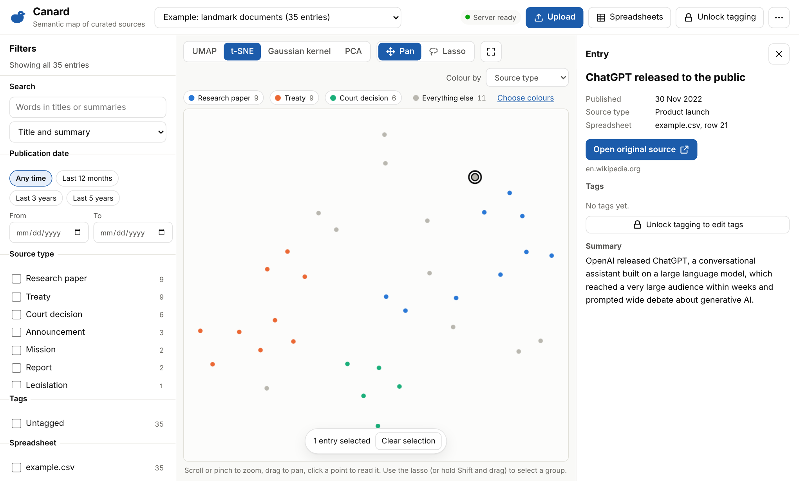

# Canard

Canard turns a hand-made spreadsheet of sources into a semantic map. Each row's title and summary is converted into a vector by an embedding model, and the vectors are plotted in two dimensions so that entries about similar things sit close together. You can switch between four projections (UMAP, t-SNE, Gaussian kernel PCA and PCA), filter by metadata, select points individually or with a lasso, read each entry in a side panel and tag groups of entries.



- **Site:** https://thomas-amann-ipaustralia.github.io/Canard/ (after the set-up below)
- **Viewing** needs no password. **Uploading or deleting** a spreadsheet needs the upload password every time. **Tagging** needs the tagging password once per browser session.
- Everything is stored in this repository's `data/` folder. Because the repository is public, **anything you upload (titles, summaries, links and tags) is public too.**

## How it works

```
 Browser (GitHub Pages)                                Render (free)            GitHub
 ┌──────────────────────────────────────────┐        ┌────────────────┐      ┌──────────────┐
 │ view: reads data/ straight from Pages    │        │ Canard API     │      │ this repo    │
 │ upload: validate CSV → embed → layouts ──┼──────► │ check password │ ───► │ data/ commit │
 │ tag: optimistic update ──────────────────┼──────► │ re-validate    │      └──────┬───────┘
 └──────────────────────────────────────────┘        └────────────────┘             │
              ▲                                                                       │
              └──────────── GitHub Actions republishes the site (about a minute) ◄───┘
```

- **The heavy work happens in the browser.** Render's free tier has a tenth of a CPU, so the uploader's browser validates the CSV, runs the embedding model ([bge-small-en-v1.5](https://huggingface.co/BAAI/bge-small-en-v1.5) through [transformers.js](https://github.com/huggingface/transformers.js), on the GPU where available) and computes all four layouts in web workers.
- **The server is small.** It checks passwords, repeats every validation check (including the token limit, with the same tokenizer), and commits the result to `data/` as a single commit through the GitHub API.
- **Switching views is instant** because all four layouts are calculated at upload time and stored. Switching only animates points between stored positions.
- **New uploads keep the map's orientation.** Each new layout is rotated to line up with the previous one, so existing clusters stay roughly where they were.

### Coping with Render's cold starts

Render's free service sleeps after 15 minutes without traffic and takes up to about a minute to wake. Canard hides this where it can:

- Viewing never touches the server, so plots appear immediately.
- The page starts waking the server as soon as it loads, and a status indicator in the header shows progress.
- During an upload, the password check (which wakes the server) runs at the same time as the model download and embedding, so the wait overlaps with work that has to happen anyway.
- Tag changes appear on screen immediately and are saved in the background.
- While an upload dialog is open or tagging is unlocked, the page pings the server every 10 minutes so it does not fall asleep mid-session.
- After a change, GitHub Pages takes a minute or two to republish. In the meantime the page reads the latest data through the server, so a reload never shows stale data.

## Set-up

1. **Merge this branch into `main`.**
2. **Turn on GitHub Pages.** In the repository go to *Settings > Pages* and set *Source* to **GitHub Actions**. The *Publish site* workflow then deploys the site on every push to `main`.
3. **Create a GitHub token for the server.** Go to *GitHub > Settings > Developer settings > Fine-grained personal access tokens*, create a token with access to **only** `Thomas-Amann-IPAustralia/Canard` and the repository permission **Contents: Read and write**. Copy it.
4. **Create the Render service.** In Render choose *New > Blueprint*, connect this repository and accept `render.yaml`. When prompted, enter:
   - `GITHUB_TOKEN`: the token from step 3
   - `CANARD_ADMIN_PASSWORD`: the password for uploading and deleting
   - `CANARD_TAG_PASSWORD`: the password for tagging (the upload password also works for tagging)

   `CANARD_SESSION_SECRET` is generated automatically.
5. **Check the server address.** The site expects `https://canard-api.onrender.com`. If Render gave the service a different address, add a repository variable named `CANARD_API_URL` with that address (*Settings > Secrets and variables > Actions > Variables*), then re-run the *Publish site* workflow.
6. Open the site. The header shows **Server ready** once the server is awake.

The repository includes an example plot (*Example: landmark documents*) so there is something to explore straight away. Delete it from the *Spreadsheets* dialog once you have uploaded your own data.

### Server settings

| Variable | Purpose | Default |
| --- | --- | --- |
| `CANARD_ADMIN_PASSWORD` | Password for uploads and deletions (and tagging). Editing is switched off if it is missing. | none |
| `CANARD_TAG_PASSWORD` | Password for tagging sessions | the admin password |
| `CANARD_SESSION_SECRET` | Signs tagging sessions so they survive server restarts | random at start-up |
| `CANARD_SESSION_HOURS` | How long a tagging session lasts | `12` |
| `GITHUB_TOKEN` | Fine-grained token with Contents read and write on this repository | none |
| `GITHUB_REPO`, `GITHUB_BRANCH` | Where data is committed | `Thomas-Amann-IPAustralia/Canard`, `main` |
| `CANARD_DATA_DIR` | Folder in the repository that holds the data | `data` |
| `CANARD_ALLOWED_ORIGINS` | Comma-separated sites allowed to call the API | the GitHub Pages site and localhost |
| `CANARD_STORE` | `github`, or `local` to write to a folder (development) | `github` when a token is set |

Ten wrong passwords from one address within 15 minutes lock that address out for the rest of the window, and 100 wrong passwords in total lock all password checks for 15 minutes.

## Using Canard

### Preparing a spreadsheet

Download the template from the *Upload* dialog or the *More options* menu. The CSV must have exactly these five columns, in this order:

| Column | Rules |
| --- | --- |
| Title | Required |
| Summary | Required. Line breaks are fine (Excel handles the quoting). |
| Source link | Required. A full web address starting with `http://` or `https://`. |
| Publication Date | Required. `YYYY-MM-DD` is safest. `DD/MM/YYYY` (Australian order), `5 March 2024` and `March 5, 2024` also work. If only the year or month is known, use the first day. |
| Source type | Required. A short category such as *Journal article* or *News* (60 characters at most). Capitalisation is matched to entries already in the plot. |

The title and summary of each entry together must fit in the embedding model's limit of **512 tokens** (roughly 380 words). In Excel, save with *File > Save As > CSV UTF-8 (Comma delimited)*.

Files that break a rule are rejected before anything is uploaded, with a list of every problem and the spreadsheet row it is on, for example:

> **Row 7** ("Patent reform in…"): the title and summary together are 634 tokens long, but the embedding model accepts at most 512. Shorten this entry by at least 122 tokens (roughly 92 words).

At most 2,000 entries can be uploaded at once, and a plot can hold up to 5,000 entries.

### Uploading

Choose *Upload*, pick an existing plot or create a new one, choose the file and enter the upload password. The first upload on a computer downloads the embedding model (about 128 MB, cached afterwards). Embedding runs on the GPU where the browser supports WebGPU, and otherwise across several CPU cores. As a guide, embedding 600 entries took about 30 seconds on a four-core test machine without a GPU, and the layouts a further 2 seconds.

### Exploring

- **Views:** UMAP, t-SNE, Gaussian kernel PCA and PCA (keys 1 to 4). Distances between t-SNE clusters are not meaningful; UMAP keeps more of the overall shape; the Gaussian kernel and PCA views are smooth, repeatable projections.
- **Zoom and pan:** scroll or pinch to zoom, drag to pan, double-click to zoom in, `0` to fit everything.
- **Read an entry:** click a point (or an item in the *Matching entries* list) to open the side panel with the summary and a link to the original source.
- **Select a group:** use the lasso (`L`), or hold Shift and drag. Shift adds to the selection and Alt removes from it. Shift-click adds or removes single points.
- **Filter:** by words in the title or summary, publication date, source type, tag and spreadsheet. Non-matching points fade (or hide, if you prefer).
- **Colour:** by source type, tag, spreadsheet or publication date. Up to three values are highlighted at a time so the colours stay easy to tell apart; choose which with *Choose colours*.
- **Export:** *More options > Download matching entries* saves the filtered entries, with their tags, as a CSV.

### Tagging

Choose *Unlock tagging* and enter the tagging password once; the session lasts until the browser tab is closed. Then select points and type tags (comma-separated) in the side panel. Tags are added to every selected entry, can be removed with the × on each tag, and become filters straight away.

### Deleting

*Spreadsheets* lists the spreadsheets in the current plot, lets you download each original file, and deletes a spreadsheet (with its entries and tags) or the whole plot with the upload password. The remaining points keep their positions. Deleted data stays in the repository's git history.

## Data layout

```
data/
  index.json                                 list of plots
  plots/<plot>/plot.json                     name, embedding model, spreadsheets, layout settings
  plots/<plot>/points.json                   every entry with its tags and coordinates for each view
  plots/<plot>/sheets/<sheet>/source.csv     the spreadsheet as uploaded
  plots/<plot>/sheets/<sheet>/vectors.json   the 384-dimension embedding of each entry
```

Files are written one entry per line, so commits show readable diffs. Coordinates are scaled to the range −1 to 1.

## Development

```bash
# Tests (no installs needed for the JavaScript tests)
npm test
pip install -r server/requirements-dev.txt
cd server && python -m pytest -q

# Run everything locally, writing to ./data instead of GitHub
cd server
CANARD_STORE=local CANARD_ADMIN_PASSWORD=admin CANARD_SESSION_SECRET=dev uvicorn app.main:app --port 8787
# in another terminal, from the repository root
CANARD_API_URL=http://localhost:8787 node scripts/dev-server.mjs 8000
```

An end-to-end test drives the whole workflow in Chromium (upload, views, lasso, tagging, reload and deletion):

```bash
npm install --no-save playwright && npx playwright install chromium
node tests/e2e/upload-flow.mjs
```

### Code map

| Path | What it does |
| --- | --- |
| `site/js/csv.js`, `server/app/validation.py` | CSV parsing and validation. The two are kept identical by the shared cases in `tests/fixtures/csv` (regenerate the expected output with `npm run fixtures`). |
| `site/js/projection/` | t-SNE (Barnes-Hut), UMAP, Gaussian kernel PCA and PCA, written for typed arrays. Their quality was checked against scikit-learn and umap-learn on the digits data set (trustworthiness within 0.001 of the reference libraries). |
| `site/js/layout-runner.js` | Runs the layouts in three web workers at once |
| `site/js/embedder.js` | Runs the embedding model in web workers |
| `site/js/scatter.js` | Canvas scatter plot: zoom, pan, hover, lasso and animated transitions |
| `server/app/` | FastAPI service: passwords, sessions, validation and commits through the GitHub Git Data API |

The tokenizer (`tokenizer.json`) is stored in the repository twice, for the browser and the server; a test checks the copies are identical. The browser tokenizer library is vendored in `site/vendor/` (Apache 2.0).
